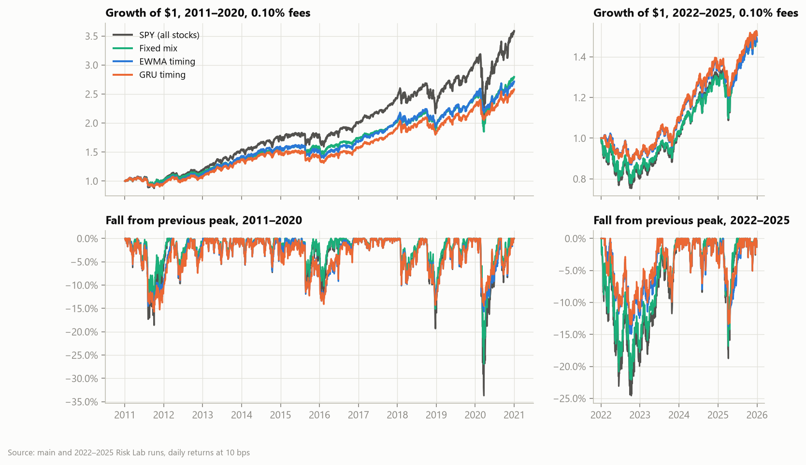

# ETF protection and volatility timing

By Sushmit Deb, Jake Ryan and Rahini Gaikwad.

Can a stock investor protect against market falls better than by simply holding
less stock? This project tests that question on U.S. ETF data. It starts with an
eight-ETF diversification study, asks which ETFs beat cash in falling months, and
ends with a rebuild and extension of the target-volatility strategy in Kaczmarek
et al. (2022, [doi](https://doi.org/10.1016/j.ribaf.2021.101610)).

That strategy forecasts market volatility each day for the session two trading
days ahead, the one its trade earns after a one-day execution delay, and holds
`10% ÷ forecast volatility` in SPY (at most 100%), with the rest in cash. On
"storm" days, when the forecast exceeds its past-only 90th percentile, up to 20%
moves from cash into one defensive ETF: long Treasuries (TLT), gold (GLD) or
commodities (DBC). Each timing portfolio is compared with a *fixed mix* that
always holds the timing portfolio's average stock share in a calibration year
(2010, or 2021 for the later test), and with SPY. Trades execute one day
after the forecast and pay fees. The forecasting models are EWMA, ARFIMA, GARCH,
GJR-GARCH and two GRU neural networks.

## What we found

Holding less stock was hard to beat. The eight-ETF mix was calmer than SPY, but
over 2018–2025 a SPY-plus-cash mix calibrated to the mix's 2010–2017 stock
sensitivity (69.19% SPY) had a slightly higher Sharpe ratio (0.639 against 0.619).
In 2015–2025, none of 13 candidate ETFs showed a reliably positive average
contribution against cash in months when SPY fell, and eleven had negative
effects that survived Holm adjustment.

Volatility timing roughly halved the worst falls while holding more stock on
average than its fixed mix (EWMA 89% against 78%). In COVID, timing portfolios
lost 10% to 16% across six models, against 21% to 27% for their fixed mixes and
34% for SPY. Timing protects against sharp crashes, not slow declines: in the slow
2015–16 fall EWMA timing lost more than its fixed mix (−13.9% against −10.2%). It
did not reliably earn more per unit of risk. No portfolio test is significant
after multiple-testing adjustment, in 2011–2020 or 2022–2025, and trading costs
erode most models' before-fee edge.



Matched study on Risk Lab volatility, 2011–2020, fees of 0.10% of each dollar
traded. Worst fall is maximum drawdown.

| Strategy | Sharpe (timing / fixed mix) | Worst fall (timing / fixed mix) |
|---|---|---|
| EWMA | 0.845 / 0.796 | −15.7% / −26.9% |
| ARFIMA | 0.819 / 0.795 | −15.4% / −25.1% |
| GARCH | 0.773 / 0.795 | −14.1% / −21.0% |
| GJR | 0.781 / 0.795 | −14.7% / −22.2% |
| GRU (one input) | 0.815 / 0.796 | −15.7% / −27.2% |
| GRU (richer inputs) | 0.829 / 0.796 | −15.4% / −27.1% |
| SPY | 0.797 | −33.7% |

On the paper's original Oxford-Man volatility data the same realistic test left
timing at or below its fixed mix (Sharpe 0.76 against 0.80 for ARFIMA, 0.80
against 0.80 for the one-input GRU).

The one-input GRU had the lowest QLIKE forecast loss (a loss that stays valid
when measured variance is noisy), significantly lower than EWMA and GARCH, but
that did not turn into reliably better portfolios. Long Treasuries were the worst
storm-day asset in 2022–2025, when bonds fell with stocks (TLT against cash: raw
p 0.031, not significant after Holm adjustment). All results are retrospective and exploratory: the test
years had been examined before. They do not establish a reliable safe haven or a
profitable forecasting edge.

Full results: [Risk Lab findings](docs/findings-risklab.md) (current study, with
figures), [Final study](docs/final-study.md) (paper rebuild and realistic trading
test) and [Results explained](docs/results-explained.md) (the earlier ETF studies).

## The studies

| Study | Question | Write-up |
|---|---|---|
| Phases 1–4 (2010–2025) | Does an eight-ETF mix beat SPY, and a SPY-plus-cash mix with the same stock exposure? | [Phase 1](docs/phase-1.md), [2](docs/phase-2.md), [3](docs/phase-3.md), [4](docs/phase-4.md) |
| Protection study | Which of 13 ETFs beat cash in months when SPY fell? | [Results explained](docs/results-explained.md) |
| Paper rebuild (2010–2020) | Can the paper's five forecasting models and strategy be rebuilt on public data? | [Final study](docs/final-study.md) |
| Realistic trading test | Does timing beat a fixed mix with a one-day delay, fees and interest on cash? | [Final study](docs/final-study.md) |
| Matched study on Risk Lab volatility (2011–2020) | The realistic test on a consistent volatility source, with gap-aware histories and robust forecast scoring | [Risk Lab findings](docs/findings-risklab.md) |
| Later years (2022–2025) | Does the result hold out of the paper's period, and which safe asset helps? | [Risk Lab findings](docs/findings-risklab.md) |

[Methodology](docs/methodology.md) has the formulas, sources and assumptions.

## Running it

You need [uv](https://docs.astral.sh/uv/getting-started/installation/) and
Python 3.12. The first study uses free public data (Yahoo Finance prices and
Kenneth French factors):

```sh
uv sync --frozen
uv run fecon download
uv run fecon analyze
uv run fecon stress
uv run fecon compare
uv run fecon explain
uv run fecon page
```

Phases 1–4 write `outputs/phase1/summary.md` through `outputs/phase4/summary.md`,
and `fecon page` combines them into `outputs/page/index.html`. Skip the download
when the snapshot already exists. New snapshots and runs need new directory names.

The later studies need licensed data and a GPU:

- WRDS/CRSP ETF total returns and the WRDS/EIA macro snapshot (yields, Brent),
  downloaded with your own WRDS account.
- The [Risk Lab](https://dachxiu.chicagobooth.edu/) SPY volatility series
  (research use only). The matched study requires it.
- A GPU for the GRU models: NVIDIA with the `prediction` extra, or a Windows AMD
  Radeon gfx1151 (8060S class) with `prediction-rocm`. The two extras cannot be
  installed together; on AMD, replace `prediction` in the command below.

With those inputs present, the matched study runs in stages (PowerShell). The
directory names are the authors' dated snapshots; use your own. All five stages took
about 30 minutes on an AMD Radeon 8060S in October 2026.

```powershell
$revisedArgs = @('--data-dir', 'data/paper-wrds-eia-20261021', '--returns-dir', 'data/protection-long-wrds-20261021', '--risklab-dir', 'data/risklab-spy-20261022', '--output-dir', 'outputs/revised-study-new')
foreach ($stage in @('freeze', 'classical', 'gru_univar_log', 'gru_multivar_log', 'evaluate')) {
    uv run --extra prediction --extra reconstruction fecon paper-revised $stage @revisedArgs
    if ($LASTEXITCODE -ne 0) { break }
}
```

The 2022–2025 study commands are under
[Reproduce](docs/findings-risklab.md#reproduce) in the Risk Lab findings. The
protection study, the paper rebuild and the WRDS download commands are in the
[command reference](docs/commands.md), and `uv run fecon --help` lists every
command. [handover.md](handover.md) is the dated project log.

## Repository layout

| Path | Contents |
|---|---|
| `src/financial_economics/` | The `fecon` package: `datasets`, `settings`, `models`, `portfolio`, `evaluation`, `studies`, `reporting` ([structure](docs/structure.md)) |
| `configs/` | Study settings, one TOML file per study |
| `docs/` | Write-ups, methods, command reference; `docs/figures/` holds the findings figures |
| `scripts/` | Independent verification, figure and supplement scripts |
| `supplement/` | Supplemental workbook and a one-month T-bill cash illustration |
| `tests/` | Synthetic-data tests that never call live data providers |
| `handover.md` | Dated project log: decisions, runs, branches and open work |

Downloaded data and results stay local in the ignored `data/` and `outputs/`
directories. Licensed WRDS observations must not be uploaded or redistributed.
See [CONTRIBUTING.md](CONTRIBUTING.md) to work on the code.

## Authors and license

Sushmit Deb, Jake Ryan and Rahini Gaikwad.

The code and documentation are released under the [MIT License](LICENSE). The
license covers this repository only. Data from WRDS, Risk Lab, Oxford-Man and other
providers is not included and stays under each provider's own terms.
