# Findings with Risk Lab volatility

The study's question: **can an investor protect against stock-market falls
better than by simply holding less stock?** The strategy, from Kaczmarek et
al. (2022), forecasts tomorrow's market volatility each day and holds
`10% ÷ forecast volatility` in stocks (at most 100%), the rest in cash. On
"storm" days, when the forecast exceeds the past-only 90th percentile, up to
20% can move from cash into one defensive ETF. Every timing portfolio is
compared with a **fixed mix** holding its average 2010 (or 2021) stock share,
and with SPY. Trades execute one day after the forecast, pay fees, start in
cash and are sold at the end.

Since October 22, 2026 the volatility measure is **Risk Lab SPY 5-minute
realized variance** (`trade_rv5`, Dacheng Xiu, Chicago Booth), one consistent
series from 1996 to 2026. Oxford-Man, the paper's source, ends in February
2022. All results are exploratory: these years have been examined before.

Figures are in [`docs/figures/risklab`](figures/risklab); each is redrawn from
hash-verified runs by [`scripts/make_findings_figures.py`](../scripts/make_findings_figures.py).

## The answer in one paragraph

Timing roughly halved the worst falls (COVID: −10% to −16% across the six
models against −21% to −27% for their fixed mixes and −34% for SPY) while holding more stock on average.
It did not reliably earn more per unit of risk: no portfolio test is
significant after adjustment, in 2011–2020 or 2022–2025, and trading costs
erode most models' before-fee edge. The GRUs forecast volatility best under
QLIKE, significantly so against EWMA and GARCH, but that did not turn into
reliably better portfolios. Long Treasuries were the worst storm-day asset in
2022–2025, when bonds fell with stocks. These conclusions hold with Oxford-Man
or Risk Lab data. The sign of timing's 2022–2025 Sharpe advantage, however, does
not survive a change in missing-date handling.

## 1. Is Risk Lab a fair substitute for Oxford-Man?

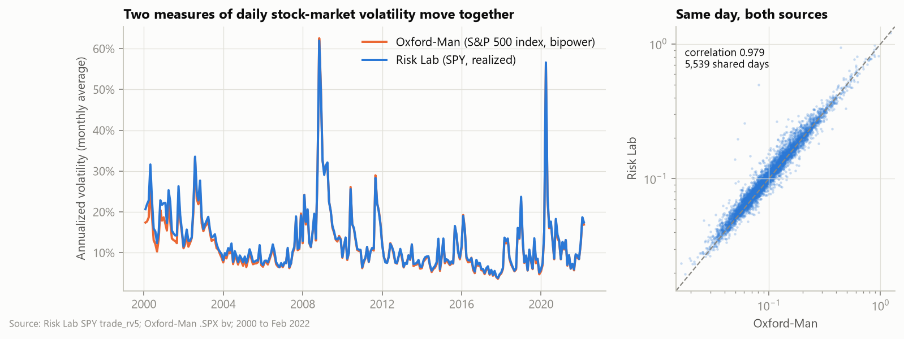

- Over 5,539 shared days (2000 to Feb 2022) the two volatility series
  correlate **0.979** (logs 0.981). Risk Lab averages 12.7% against 12.1%,
  partly because realized variance keeps the jumps that bipower variation
  removes, and partly because it measures SPY trades rather than the index.
- Run through identical code over 2011–2020, the two sources give the same
  conclusions: 0 of 27 tests significant with either, all 27 estimates with
  the same sign, the same forecast-accuracy ranking.

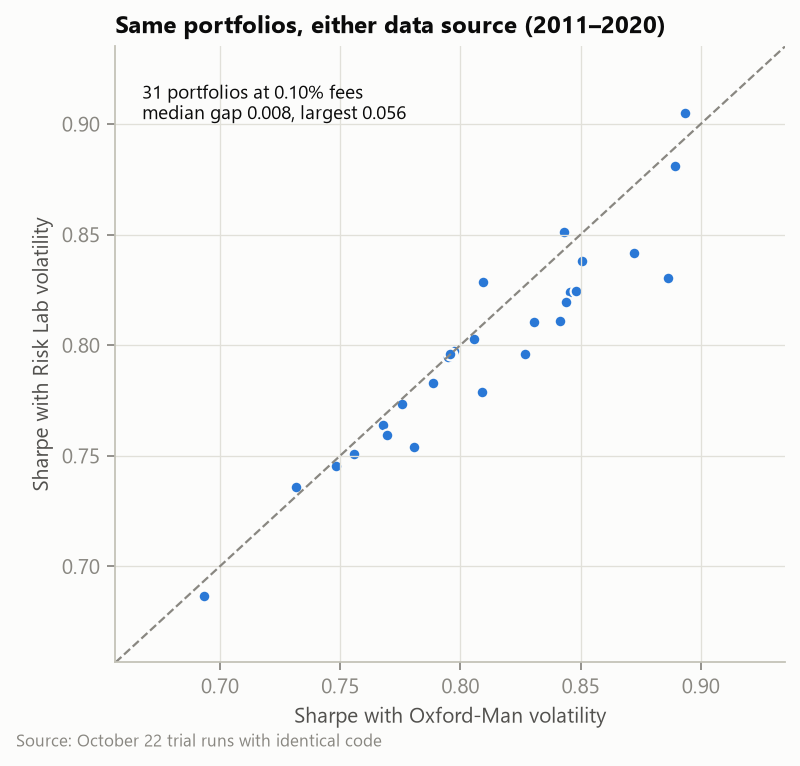

Across 31 portfolios at 0.10% fees the median Sharpe gap is 0.008 and the
largest 0.056. The sources agree on conclusions, but their exact numbers
should not be mixed in one table.

## 2. Forecast accuracy depends on how it is measured

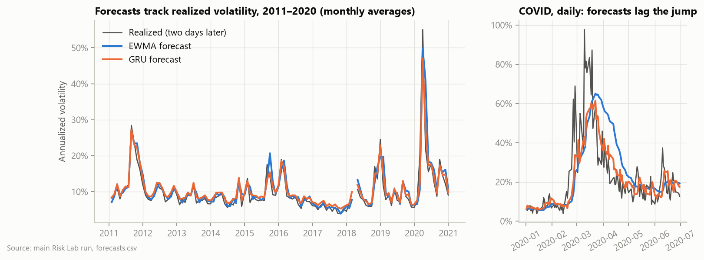

All models track realized volatility and lag sudden jumps (COVID, right). The
gap in early 2018 is deliberate: Risk Lab lacks February 5–9, 2018, and no
forecast is issued until 22 complete sessions are available again.

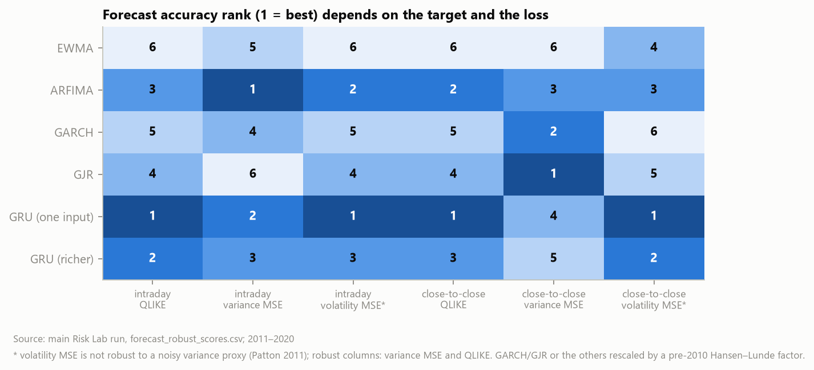

Two measurement choices change the ranking:

- **Different targets (Hansen–Lunde).** GARCH and GJR forecast close-to-close
  variance, which includes the overnight move; the other models forecast
  intraday variance. Scoring every model only against intraday variance
  handicaps GARCH. Each model is now scored against both targets, rescaling
  the other kind by a factor estimated on 2000–2009 only (close-to-close
  variance ≈ 1.47 × intraday).
- **Metric choice (Patton 2011).** Variance MSE and QLIKE stay consistent
  when the target is a noisy measure of true variance; volatility MSE does not.

Results, 2011–2020, 2,447 days with both targets observed:

| Loss | Intraday target, best | Close-to-close target, best | Significant differences (Holm, 5%) |
|---|---|---|---|
| QLIKE | One-input GRU | One-input GRU | GRU beats EWMA, ARFIMA, GARCH and GJR (intraday); beats EWMA and GARCH (close-to-close) |
| Variance MSE | ARFIMA | GJR, then GARCH | None |
| Volatility MSE (not robust) | One-input GRU | One-input GRU | GRU beats GARCH and GJR (intraday) |

The ranking flips with the loss: variance MSE favours ARFIMA, volatility
MSE the GRU. On the close-to-close target GARCH and GJR rank first and second
by variance MSE, so their poor intraday showing was partly a target mismatch.
The defensible claim is the narrow one: **the one-input GRU has the lowest
QLIKE on both targets**; no model is distinguishable by variance MSE.

## 3. Timing cuts stock when risk rises

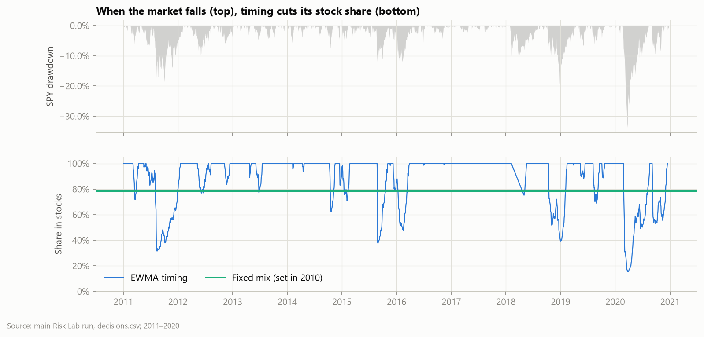

EWMA timing sits at 100% stocks in calm markets and falls to 15–40% in the
2011, 2015–16, 2018 and 2020 sell-offs. On average it held more stock than its
fixed mix (EWMA 89% against 78%; GARCH 77% against 60%).

## 4. Smaller crashes, not higher risk-adjusted returns

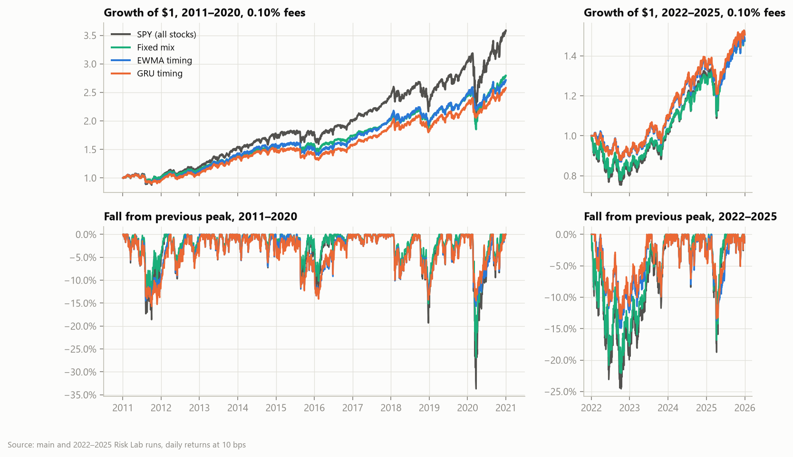

2011–2020, 0.10% fees:

| Strategy | Sharpe (timing / fixed mix) | Worst fall (timing / fixed mix) |
|---|---|---|
| EWMA | 0.845 / 0.796 | −15.7% / −26.9% |
| ARFIMA | 0.819 / 0.795 | −15.4% / −25.1% |
| GARCH | 0.773 / 0.795 | −14.1% / −21.0% |
| GJR | 0.781 / 0.795 | −14.7% / −22.2% |
| GRU (one input) | 0.815 / 0.796 | −15.7% / −27.2% |
| GRU (richer inputs) | 0.829 / 0.796 | −15.4% / −27.1% |
| SPY | 0.797 | −33.7% |

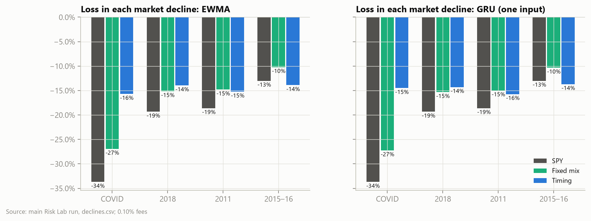

Timing protects against sharp crashes but not slow declines: it lost less
than the fixed mix in COVID, about the same in 2018 and 2011, and more in the
slow 2015–16 fall (EWMA −13.9% against −10.2%).

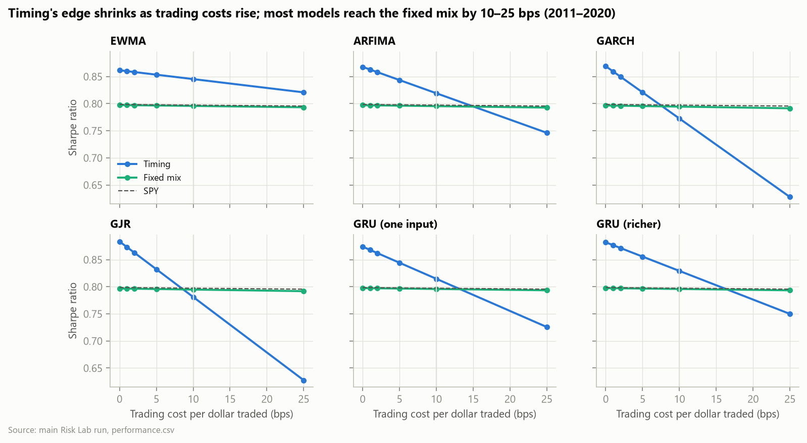

Before fees every timing strategy beats its fixed mix (Sharpe 0.86–0.88
against 0.80). Costs erode that: at 0.25% per dollar traded only EWMA, which
trades least, stays ahead (0.82 against 0.79). GARCH and GJR fall to 0.63.

## 5. Did the safe assets help? (2022–2025)

The 2022–2025 test trains on Risk Lab through 2020, calibrates on 2021 and
evaluates 2022–2025 with EWMA and the one-input GRU (the richer GRU's macro
inputs end in 2020 here).

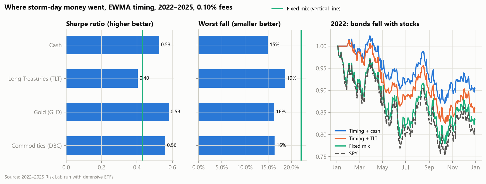

Long Treasuries were the worst storm-day choice: in 2022 bonds fell with
stocks, so moving money into TLT deepened losses (EWMA timing −14.2% in 2022
with TLT against −9.6% with cash). Gold and commodities did best. TLT against
cash came closest to significance (raw p 0.031 for the GRU, 0.059 for EWMA)
but no test survives Holm adjustment.

## 6. What changes with the missing-date rule

Risk Lab lacks 8 market days in 2000–2020 (including February 5–9, 2018) and
20 scattered days in 2021–2025. In the main runs no model treats observations
either side of a gap as adjacent lags: the current code issues a forecast only
when all 22 history sessions are observed, and ARFIMA restarts its filter at
every gap. In 2011–2020 that skips 71 of about 2,500 issue dates.
In 2022–2025 it removes a fresh signal on 30% of days, because each scattered
gap blocks the next 22 sessions; the portfolio then holds its last position.

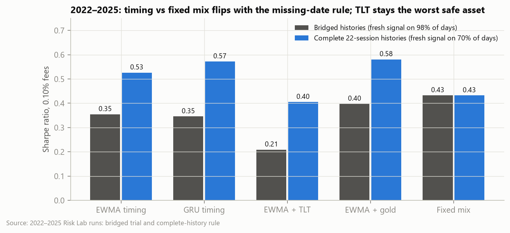

On days where both rules issue a signal the stock share is identical, so the
difference comes entirely from positions frozen for weeks. Under the strict
rule timing beats the fixed mix (EWMA 0.53, GRU 0.57 against 0.43); with
bridged histories it trails (0.35 against 0.43). **The sign of timing's
2022–2025 Sharpe advantage is therefore not a finding.** What survives both
rules: a smaller worst fall than the fixed mix (strict −14.9% against −22.1%;
bridged −19.0% against −22.5%), TLT as the worst storm-day asset, the GRU
roughly equal to EWMA, and no significant test.

## 7. Significance

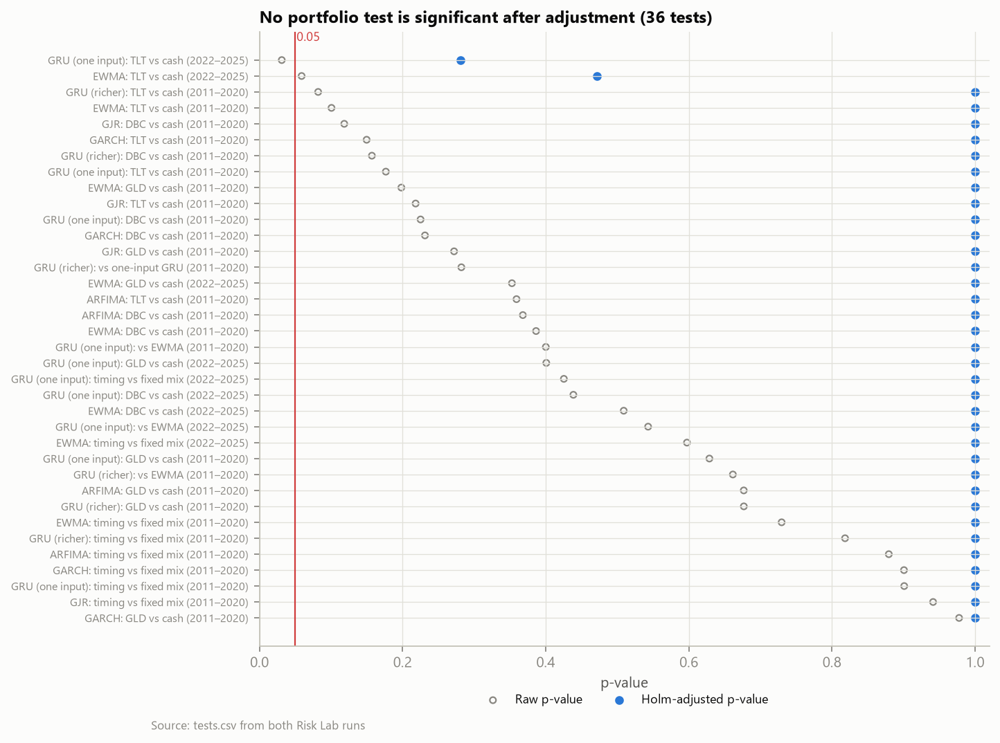

All 36 portfolio tests (27 for 2011–2020, 9 for 2022–2025) have Holm-adjusted
p-values far above 0.05. The smallest raw p-values are TLT against cash.
Non-significance does not establish equivalence.

## Method notes

- **EWMA** is a truncated normalized average: the last 22 daily variances,
  all from consecutive sessions, weighted 0.94^k and divided by the weight
  sum; the two-day forecast holds that level. It is not the recursive
  RiskMetrics filter, whose weights extend over the whole history.
- **Missing dates** are never filled. Targets without a measurement stay
  unscored.
- **GRU training** used MIOpen on an AMD Radeon 8060S with deterministic
  settings; TF32 is off on NVIDIA.
- **Comparison with Oxford-Man** uses the October 22 trial runs, which share
  code and bridge gaps; the main figures use the current strict rule.

## Caveats

- Risk Lab measures SPY trades with realized variance, not the S&P 500 index
  with bipower variation, so this is an extension of the paper, not a
  replication. Cite the October 22, 2026 download and the hash in its manifest.
- The missing 2018 crash week is unlikely to be random.
- 2022–2025 had already been examined in an earlier pilot. Only data after
  2025 would be untouched.
- Taxes are excluded; fees are scenarios.

## Reproduce

These commands produced the main 2011–2020 and 2022–2025 runs on an AMD GPU; the
Oxford-Man comparison in section 1 uses the October 22 trial runs. Run them in an
environment with the `prediction-rocm` (or `prediction`) and `reconstruction`
extras, for example after `uv sync --frozen --extra prediction-rocm --extra
reconstruction` and activating `.venv`. The original runs named the list `$args`;
it is `$inputs` here because `$args` is reserved in PowerShell. `data/` and
`outputs/` stay local.

```powershell
$inputs = @('--data-dir', 'data/paper-wrds-eia-20261021', '--returns-dir', 'data/protection-long-wrds-20261021', '--risklab-dir', 'data/risklab-spy-20261022')
foreach ($s in 'freeze', 'classical', 'gru_univar_log', 'gru_multivar_log', 'evaluate') {
    fecon paper-revised $s @inputs --output-dir outputs/revised-risklab-20261022 }
foreach ($s in 'freeze', 'forecast', 'evaluate') {
    fecon risklab-study $s @inputs --defensive-assets --output-dir outputs/risklab-2022-2025-20261022 }
```

Figures: the command in the docstring of `scripts/make_findings_figures.py`.
